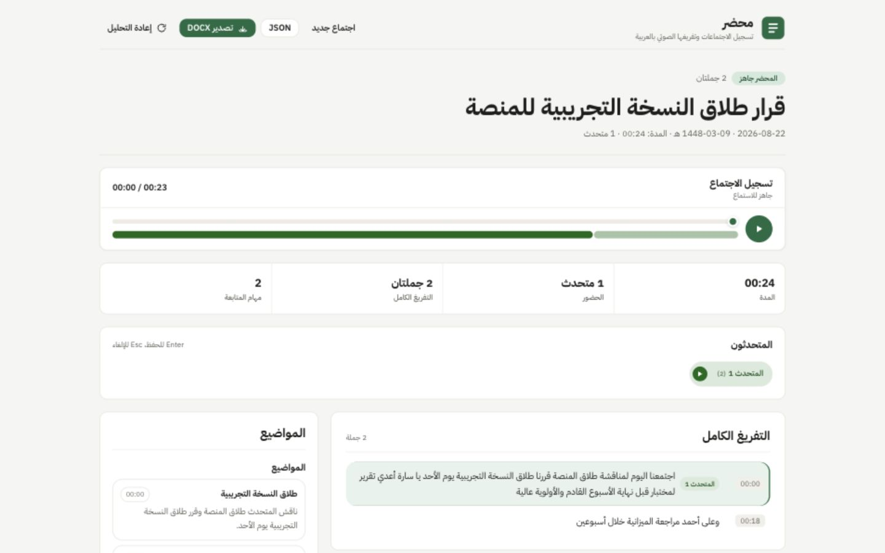

<div align="center">
  <h1>محضر | Mahdar</h1>
  <p><strong>Arabic meetings, from recording to structured minutes.</strong></p>
  <p>
    Record from the browser or upload an existing file, then review the transcript,
    speakers, decisions, directives, and follow-up tasks in one Arabic RTL workspace.
  </p>
  <p>
    <a href="#run-with-docker">Run with Docker</a> ·
    <a href="#how-it-works">Architecture</a> ·
    <a href="#ready-made-and-built-in-this-project">Attribution</a> ·
    <a href="docs/DECISIONS.md">Technical decisions</a>
  </p>
</div>

<p align="center">
  
</p>

## Run with Docker

### Requirements

- Docker with Compose
- A Groq API key
- A Hugging Face read token with access to
  `pyannote/speaker-diarization-community-1` for speaker separation

### Start

```bash
cp .env.example .env
```

Add `GROQ_API_KEY` and `HF_TOKEN` to `.env`, then run:

```bash
docker compose up --build
```

Open [http://localhost:8100](http://localhost:8100). No database setup, migration,
or manual service startup is required.

## What the app delivers

- Browser recording with a timer, volume level, pause, resume, and upload progress
- Upload support for WebM, OGG, WAV, MP3, M4A, and MP4 files
- Arabic transcription with sentence-level timestamps
- Speaker separation with editable speaker names
- Audio playback and seeking from transcript sentences and minutes items
- Arabic meeting title, topics, decisions, directives, and follow-up tasks
- Task owner, priority, and Gregorian and Hijri due dates when a date is stated
- DOCX and JSON exports

## How it works

```text
Browser
  |
  v
Caddy :8100
  |-- /api/*  --> FastAPI
  `-- /*      --> React + TanStack Start
                    |
                    v
        convert audio with ffmpeg
                    |
          +---------+---------+
          |                   |
       transcribe          diarize
          |                   |
          +---------+---------+
                    |
        assemble timestamped sentences
                    |
       extract and verify meeting minutes
                    |
          persist files under /data
```

Transcription and diarization run in parallel. Speaker separation is optional: if
the pyannote model or token is unavailable, the transcript and minutes can still
complete without speaker labels. Analysis is also recoverable, so a failed minutes
request does not remove a completed transcript.

## Providers

The submitted and manually tested path uses Groq for transcription and minutes
extraction:

| Stage | Default | Local alternative |
| --- | --- | --- |
| Transcription | Groq `whisper-large-v3` | faster-whisper `large-v3-turbo` |
| Speaker separation | pyannote `community-1` on CPU | Same |
| Minutes extraction | Groq `openai/gpt-oss-120b` | Configurable Ollama model; default `qwen3:8b` |

> **Local provider status:** The faster-whisper and Ollama integrations are
> implemented and covered by mocked unit tests, but the complete local path has not
> been run end to end with real model inference. It is an optional extension path,
> not part of the validated submission flow.

To use the local STT and LLM providers, set these values in `.env`:

```dotenv
STT_PROVIDER=local
LLM_PROVIDER=local
```

Then start the local profile:

```bash
docker compose --profile local up --build
```

The local path is designed as a CPU fallback and downloads model weights on first
use. Once those weights are cached in the Docker volumes, it is intended to run
without sending the recording or transcript to Groq. Its startup behavior,
performance, and output quality still need to be verified with a real end-to-end
run.

## Ready-made and built in this project

The first version was developed locally before its Git history was created. No
complete GitHub project or prebuilt meeting-minutes application was imported.
Open-source libraries, published models, and hosted model APIs were used as
building blocks.

| Ready-made component | What was used | What was built for Mahdar |
| --- | --- | --- |
| Groq, Whisper large-v3, and `gpt-oss-120b` | Hosted transcription and language-model inference | Provider clients, audio chunking, retries, prompts, schema validation, and Arabic error handling |
| pyannote `community-1` | Speaker diarization model and runtime | Audio loading, parallel execution, turn-to-sentence assignment, speaker ordering, renaming, and re-analysis |
| faster-whisper, Ollama, and Qwen | Local inference engines and published models | An optional provider path following the same pipeline contract; mocked in tests but not run with real local inference |
| FastAPI, Pydantic, Uvicorn, HTTPX, and SlowAPI | API, validation, HTTP, and rate-limit primitives | Meeting endpoints, upload checks, job lifecycle, persisted state, recovery, and exports |
| React, TanStack, Tailwind CSS, Radix, shadcn-style primitives, and Lucide | Web framework, routing, styling primitives, and icons | The RTL workflow, recording experience, processing states, audio player, transcript, speaker, minutes, and task views |
| ffmpeg and ffprobe | Audio conversion, probing, and splitting | The conversion rules, silence-aware chunking, timestamp offsets, and media workflow |
| python-docx and hijridate | Document and calendar primitives | RTL DOCX layout, export structure, and deterministic date normalization |
| Docker Compose, Caddy, Bun, Turborepo, and uv | Runtime, proxy, package, and build tooling | The one-command topology, container configuration, and repository workflow |

No model was trained or fine-tuned as part of this project. The product-specific
work is the end-to-end pipeline around these components: recording and validation,
sentence assembly, speaker attribution, evidence-linked minutes, date handling,
long-meeting processing, playback, exports, and the Arabic user experience.
Resolved dependency versions are locked in `uv.lock` and `bun.lock`; direct
requirements and pinned container images are recorded in the manifests and Compose
file.

## Data and privacy

With the default providers, audio is sent to Groq for transcription and transcript
context is sent to Groq for minutes extraction. Diarization runs locally inside the
API container. Meeting artifacts are stored in the `mahdar-data` Docker volume.

API keys belong only in `.env`. The repository includes a documented `.env.example`
with empty secret values.

## Verification

```bash
bun install --frozen-lockfile
bun run lint
bun run typecheck
bun run test
```

The automated tests mock provider calls and cover the API, audio splitting,
sentence assembly, speaker assignment, citations, dates, long-transcript analysis,
exports, recovery, and the main web utilities. The Groq Docker path was also tested
manually with real recordings. The local-provider tests use fakes and mocked HTTP
responses; they do not prove real faster-whisper or Ollama inference.

Two short Arabic clips and reference transcripts are available in `samples/` for
manual transcription checks. A real multi-speaker recording is still the best final
check for diarization and speaker turn boundaries.

## Project structure

```text
apps/api/    FastAPI service and the processing pipeline
apps/web/    React application and feature-based UI
infra/       Caddy configuration
docs/        Technical decision record
samples/     Arabic audio samples and reference transcripts
```

The API and web packages are organized by feature. The main technical trade-offs
and rejected alternatives are recorded in [`docs/DECISIONS.md`](docs/DECISIONS.md).

## Known limits

- Arabic names, dialects, overlapping speech, and noisy recordings can reduce
  transcription and speaker accuracy.
- pyannote requires an accepted model license and a valid Hugging Face token on the
  first download. Without them, speaker separation is skipped.
- The local faster-whisper and Ollama path is implemented but has not been manually
  validated end to end. It should be tested for model download, resource use,
  processing time, and output quality before being relied on.
- Very long meetings require more model calls and may be affected by provider rate
  limits. The transcript remains available if minutes extraction fails.
- The current single-worker, file-backed design is suitable for this assignment and
  small deployments, not horizontal production scaling.
